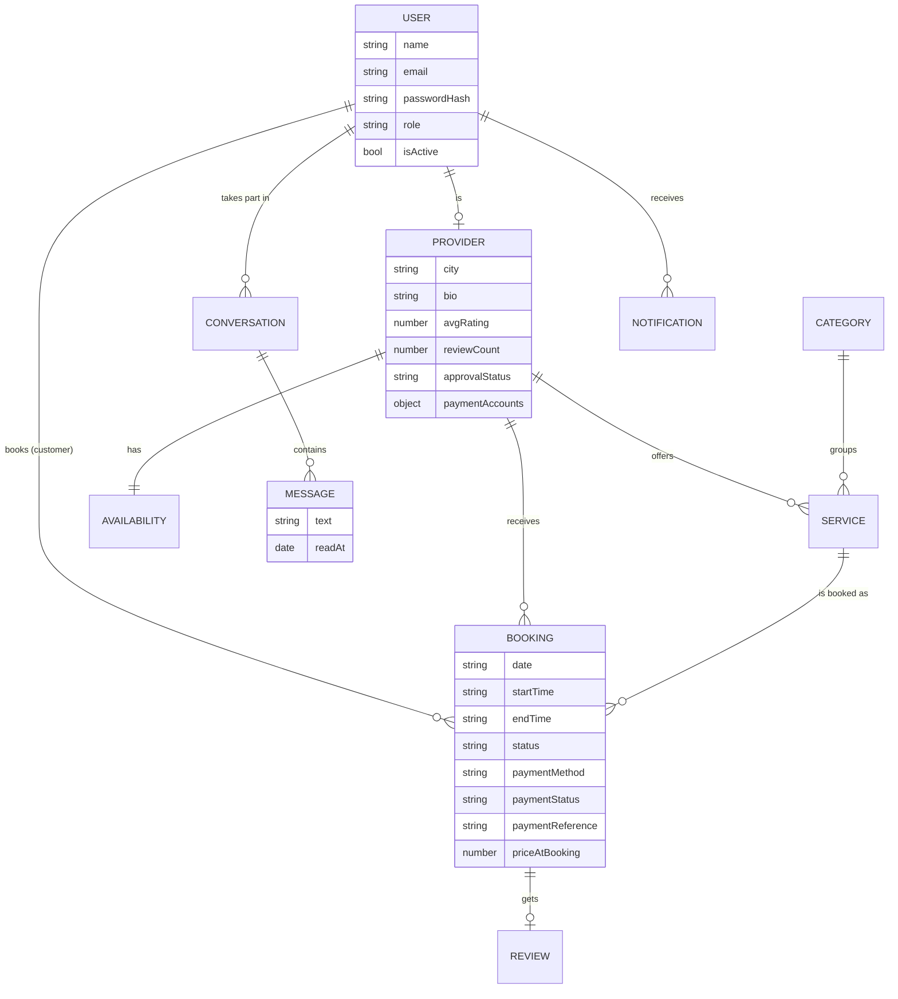

# ServiceLink

A local service marketplace and booking platform built with the MERN stack. Customers find approved providers, pick a free time slot, book, pay (cash or transfer) and chat. Providers publish services and weekly availability and handle requests. Admins approve providers and moderate the platform.

AUREX Full-Stack Engineering Internship, Month 3. **Status: Week 4 (deployment, testing, documentation, presentation).**

| | Link |
| --- | --- |
| Live app (frontend, Vercel) | `https://servicelink-front.vercel.app`  |
| Live API (backend) | `https://servicelink-zeta.vercel.app/api` |
| Source code | `https://github.com/kinzadev-26/servicelink` |


## Features

- Register and log in (JWT + bcrypt). Nobody can register as admin.
- Three roles, protected in the API (401 / 403) and in the React app.
- Providers: profile, services, weekly availability and days off; confirm, reject, complete or cancel requests.
- Customers: server-computed free slots, book, cancel, review completed bookings.
- Double booking is impossible: slot re-check plus a unique partial index in MongoDB.
- Reviews update the provider's average rating.
- Payments: cash after the service, or transfer (Easypaisa, JazzCash, bank) with a transaction id that the provider confirms or rejects.
- Messaging with a booking request, and chat between customer and provider with read receipts (Socket.IO).
- Live notifications with a bell, counter and pop-up.
- Admin: stats, approve providers, suspend users, all bookings, remove reviews, categories.

## Tech stack

| Layer | Tools |
| --- | --- |
| Frontend | React 19, Vite, Tailwind CSS v4, React Router, Axios, lucide-react, socket.io-client |
| Backend | Node 22, Express 4, Mongoose 9, Socket.IO 4, JWT, bcryptjs, express-validator |
| Security and performance | helmet, cors (allow-list), express-rate-limit, express-mongo-sanitize, compression |
| Database | MongoDB Atlas |
| Testing | Jest 30, supertest, socket.io-client, Postman, Playwright (UI checks), `npm run smoke` |
| Hosting | Vercel (frontend), Render / Railway (backend, full features) or Vercel (backend, REST only), MongoDB Atlas |


## Database (ER diagram)



## Roles and access

| Area | Guest | Customer | Provider | Admin |
| --- | --- | --- | --- | --- |
| Browse providers, services, slots, reviews | yes | yes | yes | yes |
| Book, cancel own booking, review, pay | no | yes | no | no |
| Own services, availability, requests, confirm payment | no | no | yes | no |
| Approve providers, suspend users, all bookings, categories | no | no | no | yes |

## Installation

Needs Node 20+ and a MongoDB Atlas connection string.

```
Demo accounts (password `Password123`): `customer@example.com`, `ahmed@example.com` (provider), `admin@example.com`, `pending@example.com` (provider waiting for approval).

## API

Full reference with examples: [docs/API.md](docs/API.md). Postman collection: `docs/postman/ServiceLink-Week3.postman_collection.json` (99 requests with tests).

Responses are `{ success, message, data, meta? }`; errors `{ success: false, message, errors? }`.

## Booking and payment rules

| From | To | Who |
| --- | --- | --- |
| pending | confirmed or rejected | provider |
| pending | cancelled | customer |
| confirmed | completed | provider, on or after the start time |
| confirmed | cancelled | customer or provider |

Payment: `unpaid` → `submitted` (customer, transfer only, needs transaction id) → `paid` (provider confirms, only after the booking is confirmed). A provider can reject a submitted payment (back to `unpaid` with a note). Slots = weekly hours − days off − past times − 2-hour notice today − active bookings, up to 30 days ahead. Times are Pakistan time (UTC+5).

## Real-time

One WebSocket per logged-in browser; the JWT is sent in the handshake and checked like the REST API. Each user joins room `user:<id>`; the server emits `notification`, `message:new`, `conversation:read`. Everything is also stored in MongoDB, so nothing is lost while offline. Needs a long-running server (local, Render, Railway). On a serverless host such as Vercel the REST API works but live push does not; notifications and messages then appear after a refresh.

## Testing

```bash
cd backend && npm test                         # 91 Jest tests
npm run smoke -- https://<your-api>/api         # read-only checks on the deployed API
```

Manual test cases and evidence checklist: [docs/TESTING.md](docs/TESTING.md).


## Known limitations

- Real-time needs a server that stays running (local, Render, Railway); it does not work on the Vercel-only backend.
- Payments are recorded and confirmed by hand; no online gateway (needs a merchant account).
- No password reset or email verification; no typing indicator, file sharing or offline push.
- Reviews can be removed by an admin but not edited.
- The token is in `localStorage` (readable by any script on the page).
- Free hosts sleep when idle; the first request can take about a minute.

## Future improvements

Online payment gateway, email verification and password reset, image upload for providers, map-based search, review editing, push notifications, refresh tokens with httpOnly cookies, CI pipeline with automated tests.

## Folder map

```
backend/src      config, models, routes, controllers, middleware, validators, services, utils
backend/tests    Jest tests
backend/scripts  smokeTest.js (deployed-API check)
frontend/src     components, pages, routes, context, hooks, services
docs/            API.md, DEPLOYMENT.md, TESTING.md, PRESENTATION.md, postman/, screenshots/
render.yaml      Render Blueprint for the backend
backend/railway.json, backend/vercel.json, backend/api/index.js, frontend/vercel.json   hosting config
```

## License

MIT, see [LICENSE](LICENSE).